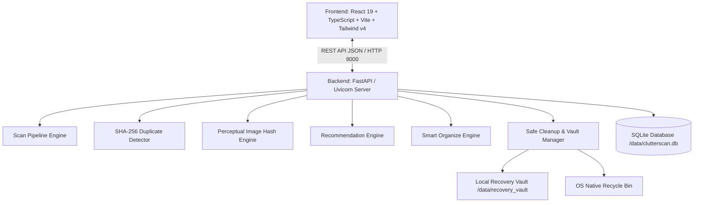

# ClutterScan: Comprehensive Architectural & Feature Guide

**ClutterScan** is a forensic local disk analysis, duplicate detection, intelligent categorization, and safe cleanup platform. Built with a **Swiss Minimalist aesthetic** (high-contrast monochrome, monospace data typography, strict grid hierarchy), it provides enterprise-grade disk insights without cloud dependencies or destructive surprises.

---

## 1. System Architecture Overview

ClutterScan runs completely **locally on your machine**, ensuring total data privacy.



---

## 2. Technology Stack Breakdown

### Frontend Technologies
| Layer | Technology | Version | Purpose & Rationale |
| :--- | :--- | :--- | :--- |
| **Framework** | **React** | `19.0.0` | Component-based UI with modern hooks and high-performance reactive updates. |
| **Language** | **TypeScript** | `5.7.2` | Strict compile-time typing for scan models, tree structures, and safety invariants. |
| **Build Tool** | **Vite** | `6.2.0` | Ultra-fast Hot Module Replacement (HMR) and optimized rollup production bundles. |
| **Styling** | **Tailwind CSS** | `4.0.0` | Utility-first CSS configured with custom Swiss Minimalist grayscale tokens (`#000000`, `#0b0b0b`, `#181818`, `#303030`, `#ffffff`). |
| **Typography** | **Google Space Mono & Inter** | CDN / Webfont | Monospace tabular numbers for hashes, byte counts, and forensic audit timestamps. |
| **Icons** | **Lucide React** | `0.475.0` | Crisp, scalable monochrome SVG iconography (`HardDrive`, `FolderTree`, `RotateCcw`, etc.). |

### Backend Technologies
| Layer | Technology | Purpose & Implementation |
| :--- | :--- | :--- |
| **Server Framework** | **FastAPI** (`0.115.6`) | High-concurrency async Python web API with automatic OpenAPI documentation at `/docs`. |
| **ASGI Server** | **Uvicorn** (`0.34.0`) | Lightning-fast ASGI production-ready HTTP server. |
| **Data Validation** | **Pydantic** (`2.10.4`) | Strict request/response payload validation and JSON serialization. |
| **Database** | **SQLite 3** | Embedded zero-configuration local database for scan snapshots, deltas, and audit history. |
| **Hashing Engine** | **Python `hashlib`** | Cryptographic SHA-256 stream hashing in 64KB chunks to safely hash multi-gigabyte files. |
| **Perceptual Vision** | **Pillow + ImageHash** | Generates 64-bit dHash (difference hashes) and computes Hamming distance for near-identical photo clustering. |
| **Recycle Bin Integration**| **Send2Trash** | Windows Shell COM wrapper to safely route deletions to native Windows Recycle Bin. |
| **Testing** | **Pytest + AnyIO** | 19 automated integration and unit tests covering end-to-end scanning, cleanup, and undo. |

---

## 3. Comprehensive Feature-by-Feature Guide

### Feature 1: Intelligent Disk Scanner & Interactive Directory Tree
* **Location**: Navigation -> `Scan` & `Storage`
* **What it does**:
  - Traverses any user-selected local volume or folder.
  - Automatically filters out OS-protected directories (e.g. `System Volume Information`, `$Recycle.Bin`, `pagefile.sys`).
  - Constructs a hierarchical file-tree with exact recursive byte counts.
  - Generates forensic directory deltas comparing consecutive scans to show where disk usage expanded or contracted.

### Feature 2: SHA-256 Exact Duplicate Detection & Bulk Folder Deletion
* **Location**: Navigation -> `Duplicates`
* **What it does**:
  - **Two-Pass Algorithm**:
    1. Fast size-grouping eliminates unique files with zero disk I/O overhead.
    2. Byte-by-byte cryptographic SHA-256 verification confirms 100% duplicate identity.
  - **Dual Inspection Views**:
    - *Folder View*: Groups duplicates by folder, allowing users to select an entire folder's duplicates and delete them with one click.
    - *Group Dossier View*: Displays exact cryptographic hashes with hex sample previews and algorithmic retention badges.
  - **Permanent Keeper Protection**: ClutterScan algorithmically protects the original reference copy, preventing users from accidentally deleting all copies of a file.

### Feature 3: Perceptual Image Clustering (Similar Photos)
* **Location**: Navigation -> `Similar images`
* **What it does**:
  - Detects photos that look alike even if resized, re-compressed, edited, or saved under different filenames.
  - Uses 64-bit **dHash (difference perceptual hash)**.
  - Computes Hamming distance ($H \le 10$) to group burst shots and redundant photos into visual clusters with similarity percentages.

### Feature 4: Recommendation Engine & Forensic Review
* **Location**: Navigation -> `File review`
* **What it does**:
  - Scores every file using an explainable, multi-factor heuristic model:
    - *Inode Inactivity*: Days since last access/modification.
    - *Storage Impact*: Heavy files penalizing disk space.
    - *Redundancy Risk*: Files with verified duplicates elsewhere.
    - *Temporary Evidence*: Known disposable formats (`.tmp`, `.log`, `.bak`, caches).
  - Displays transparent score breakdowns so users see exactly *why* a file was recommended for review.

### Feature 5: Smart Organize (Automated Categorization & 1-Click Undo)
* **Location**: Navigation -> `Smart organize`
* **What it does**:
  - **Deterministic Categorization**: Organizes chaotic folders into clean subfolders:
    - `Documents`, `Images`, `Videos`, `Audio`, `Archives`, `Code`, `Installers`, `College`, and `Unsorted`.
  - **Customizable Keywords**: Prioritizes academic/college materials (`assignment`, `lecture`, `lab`) and developer projects (`src`, `git`, `spec`).
  - **Pre-flight Conflict Detection**: Simulates all moves *before* touching disk. If a destination file already exists, it flags a conflict and halts execution for that file.
  - **Lossless Undo**: Every operation is logged in the SQLite audit ledger. Clicking **`Undo Move`** safely returns every moved file back to its original path and removes any empty subfolders created.

### Feature 6: Safe Cleanup, Audit Logging & Lossless Recovery
* **Location**: Navigation -> `Cleanup` & `History`
* **What it does**:
  - **Strict Confirmation Invariant**: No file is ever removed without user preview and explicit approval.
  - **Two-Tier Safety System**:
    1. *Windows Recycle Bin*: Sends approved files to the OS Recycle Bin via `send2trash`.
    2. *Local Recovery Vault*: Quarantines deleted files in `backend/data/recovery_vault/`.
  - **Lossless Vault Restore**: Clicking **`Restore from vault`** in the History tab immediately returns the quarantined file back into its original folder.
  - **Audit Ledger**: Complete historical log with dispatch IDs, timestamps, origin paths, and outcome statuses.

---

## 4. Directory & File Organization Reference

```
ClutterScan/
├── backend/
│   ├── app/
│   │   ├── main.py                     # FastAPI entry point & CORS configuration
│   │   ├── api/routes/
│   │   │   ├── duplicate_routes.py     # Bulk deletion & duplicate querying
│   │   │   ├── organize_routes.py      # Smart Organize scan, execute, and undo
│   │   │   ├── history_routes.py       # Recovery audit trail and vault restoration
│   │   │   ├── scan_routes.py          # Directory crawling and tree generation
│   │   │   └── system_routes.py        # Local disk volumes and folder picker
│   │   ├── services/
│   │   │   ├── organize/               # Categorizer, planner, executor, history
│   │   │   ├── cleanup/                # Recovery vault manager & trash manager
│   │   │   ├── duplicate/              # SHA-256 chunked hashing algorithm
│   │   │   ├── similar/                # Perceptual image hashing engine
│   │   │   └── recommendation/         # Multi-factor file scoring algorithm
│   │   └── database/                   # SQLite schema, migrations, connection pools
│   └── tests/                          # 19 Pytest test cases validating safety
│
├── frontend/
│   ├── src/
│   │   ├── App.tsx                     # Main layout & navigation state
│   │   ├── screens/
│   │   │   ├── OrganizeScreen.tsx      # Smart Organize UI with preview table
│   │   │   ├── DuplicatesScreen.tsx    # Bulk folder selection & deletion UI
│   │   │   ├── HistoryScreen.tsx       # Recovery log & 1-click restore
│   │   │   ├── StorageScreen.tsx       # Interactive directory tree explorer
│   │   │   ├── HomeScreen.tsx          # Initial scan & quick statistics
│   │   │   ├── ImagesScreen.tsx        # Perceptual image cluster viewer
│   │   │   └── CleanupScreen.tsx       # Safety confirmation & execution
│   │   ├── services/api.ts             # Typed fetch API client
│   │   └── types.ts                    # TypeScript data definitions
│   └── index.css                       # Swiss Minimalist monochrome theme
```

---

## 5. Development & Running Guide

### Prerequisites
- **Python 3.10+** (with virtual environment)
- **Node.js 18+** & npm

### Running the Backend
```powershell
cd "C:\Users\Krish Khandwala\ClutterScan\backend"
..\.venv\Scripts\Activate.ps1
uvicorn app.main:app --host 0.0.0.0 --port 8000 --reload
```
* Interactive Swagger API docs: `http://localhost:8000/docs`

### Running the Frontend
```powershell
cd "C:\Users\Krish Khandwala\ClutterScan\frontend"
npm run dev
```
* Live Application: `http://localhost:3000`
